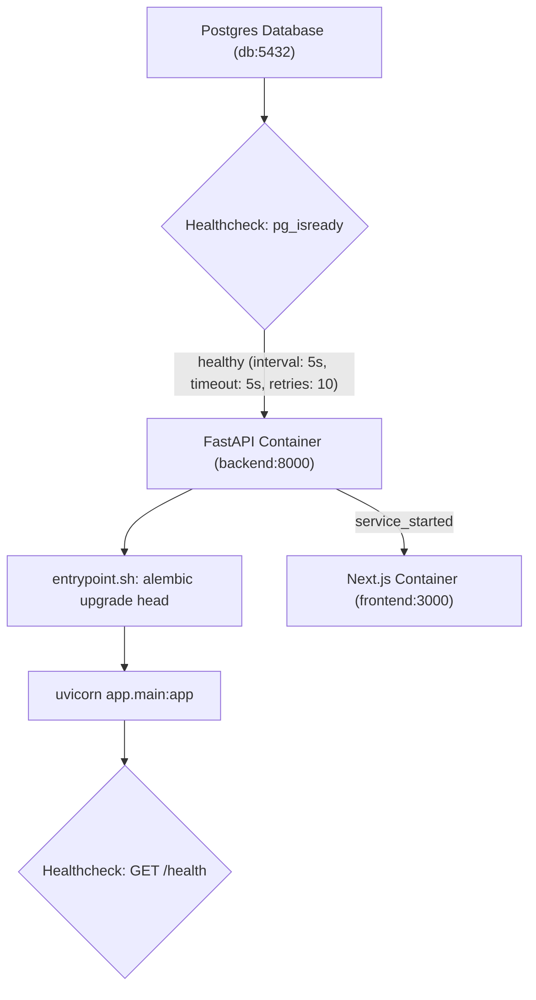

# Architecture & System Specification: SuccessfulSuccess Meetings

## 1. Overview & System Scope
This project is a containerized, monorepo meeting management platform providing authenticated users with meeting lifecycle management. The system consists strictly of a Next.js frontend, a FastAPI backend, and a PostgreSQL database.

---

## 2. Repository Layout & Directory Structure

```
.
├── .github/
│   └── workflows/              # GitHub Actions CI/CD workflows (linting, test, deploy)
├── backend/
│   ├── alembic/                # Version-controlled database migrations
│   │   ├── versions/           # Migration revision scripts
│   │   └── env.py              # Alembic environment and database engine runner
│   ├── app/
│   │   ├── api/                # HTTP route handlers, API routers, and dependencies
│   │   │   ├── v1/             # API v1 versioned endpoints (meetings)
│   │   │   └── deps.py         # FastAPI dependency injection definitions
│   │   ├── models/             # SQLAlchemy ORM database models
│   │   ├── repositories/       # Database access and query encapsulation
│   │   ├── schemas/            # Pydantic request/response validation schemas
│   │   ├── services/           # Business domain logic
│   │   ├── auth.py             # JWT token parsing, signature verification, auth rules
│   │   ├── config.py           # Application settings and environment configuration
│   │   ├── db.py               # Async SQLAlchemy engine and session factory
│   │   └── main.py             # FastAPI entrypoint and middleware definition
│   ├── tests/                  # Automated pytest test suites
│   ├── alembic.ini             # Alembic configuration
│   ├── Dockerfile              # Backend container build specification
│   ├── entrypoint.sh           # Container bootstrap script (migration execution & server start)
│   ├── pyproject.toml          # Python project metadata and dependencies
│   └── uv.lock                 # Pinned dependency lockfile
├── frontend/
│   ├── app/                    # Next.js App Router (pages, layouts, globals.css)
│   │   ├── (app)/              # Authenticated user route groups
│   │   ├── layout.tsx          # Root layout and theme providers
│   │   └── page.tsx            # Landing and dashboard views
│   ├── components/             # React UI components
│   │   ├── ui/                 # Atomic design / shadcn/ui primitives
│   │   └── *.tsx               # Domain-specific components (forms, dialogs, lists)
│   ├── hooks/                  # Client-side React hooks
│   ├── lib/                    # Shared utilities, API client, date helpers, auth logic
│   ├── public/                 # Static assets
│   ├── Dockerfile              # Frontend multi-stage container build specification
│   ├── next.config.ts          # Next.js runtime and export configuration
│   ├── package.json            # Node.js dependencies and run scripts
│   ├── package-lock.json       # Pinned Node.js dependency lockfile
│   └── tsconfig.json           # TypeScript compiler configuration
├── docker-compose.yml          # Multi-container local orchestration configuration
├── Makefile                    # Developer CLI automation tasks
└── PROJECT.md                  # System architecture and technical specification
```

### Folder & Service Purpose
- **Root**: Coordinates local orchestration (`docker-compose.yml`), workspace execution tasks (`Makefile`), and automated pipeline definitions (`.github/workflows/`).
- **`backend/`**: Asynchronous Python API service utilizing FastAPI, SQLAlchemy ORM (asyncpg), Alembic schema migrations, and `uv` package management.
- **`frontend/`**: Client application built with Next.js (App Router), React, Tailwind CSS, and shadcn/ui component primitives.
- **Strict Boundary Rules**: The system architecture explicitly excludes caching or message brokering layers (e.g., Redis, Celery), reverse proxy daemons (e.g., Nginx), or orchestration manifests (e.g., Kubernetes Helm/manifests).

---

## 3. Container & Infrastructure Specifications

### Pinned Base Image Versions
All environments must run on explicitly pinned container image base tags:
- **Database (`db`)**: `postgres:16-alpine` (Official PostgreSQL 16 Alpine minimal image)
- **Backend (`backend`)**: `python:3.12-slim` (Debian-based minimal image with pinned `uv` package manager binary from `ghcr.io/astral-sh/uv:0.4.18`)
- **Frontend (`frontend`)**: `node:22-alpine` (Node.js 22 Alpine minimal image)

### Networking & Exposed Ports
| Service | Container Port | Host Port Binding | Protocol | Description |
| :--- | :---: | :---: | :---: | :--- |
| `db` | `5432` | `${POSTGRES_PORT:-5432}` | TCP | PostgreSQL relational database |
| `backend` | `8000` | `${BACKEND_PORT:-8000}` | HTTP | FastAPI ASGI server (`uvicorn`) |
| `frontend` | `3000` | `${FRONTEND_PORT:-3000}` | HTTP | Next.js development/production server |

### Startup Lifecycle, Healthchecks & Dependency Graph


1. **Database Healthcheck**:
   - Command: `pg_isready -U ${POSTGRES_USER:-app} -d ${POSTGRES_DB:-meetings}`
   - Parameters: Interval `5s`, Timeout `5s`, Retries `10`.
2. **Backend Startup Dependency**:
   - The `backend` service specifies `depends_on: db: condition: service_healthy`.
   - The container does not initialize application processes until PostgreSQL is accepting connections.
3. **Database Migration & Process Execution**:
   - The backend entrypoint script (`/usr/local/bin/entrypoint.sh`) intercepts container startup.
   - When `RUN_MIGRATIONS_ON_START=true`, it runs `alembic upgrade head`.
   - Upon successful migration completion, the script executes `exec "$@"`, starting Uvicorn (`uvicorn app.main:app --host 0.0.0.0 --port 8000`).
4. **Backend Healthcheck**:
   - Command: `curl -fsS http://localhost:8000/health || exit 1`
   - Parameters: Interval `10s`, Timeout `5s`, Retries `10`, Start Period `20s`.
5. **Frontend Startup Dependency**:
   - The `frontend` service specifies `depends_on: backend: condition: service_started` to ensure deterministic service ordering.

---

## 4. API Contracts & Data Specifications

The backend exposes a REST API rooted at `/api/v1`. All timestamp inputs and outputs are formatted according to **ISO 8601** with mandatory UTC offset (`YYYY-MM-DDTHH:mm:ss±HH:MM` or `YYYY-MM-DDTHH:mm:ssZ`). Responses render timestamps converted to the configured application timezone (default: `Europe/Kyiv`).

### Common Header Contracts
- `Content-Type: application/json`
- `Authorization: Bearer <JWT>` (Required for meeting endpoints; verifies user identity)

---

### Endpoint: `GET /api/v1/meetings`
Retrieves a paginated list of meetings overlapping the designated date window for the authenticated user.

#### Query Parameters
| Parameter | Type | Required | Default | Description |
| :--- | :---: | :---: | :---: | :--- |
| `date` | String | No | Today (`YYYY-MM-DD`) | Target calendar day in application timezone |
| `q` | String | No | `null` | Substring search against meeting title/name and description |
| `limit` | Integer | No | `100` | Pagination page size (Min: 1, Max: 500) |
| `offset` | Integer | No | `0` | Pagination offset index (Min: 0) |

#### Response: HTTP 200 OK
```json
{
  "items": [
    {
      "id": "64c10442-643f-42de-9ab1-2db1c5f8c7bd",
      "name": "Sprint Architecture Review",
      "description": "Quarterly system design review",
      "location": "Conference Room A",
      "starts_at": "2026-11-02T10:00:00+02:00",
      "ends_at": "2026-11-02T11:00:00+02:00",
      "participants": [
        {
          "id": "e69ff6d9-2237-4ee9-87a3-e7c3d22067d4",
          "name": "Jane Doe",
          "email": "jane.doe@example.com",
          "position": 0
        }
      ],
      "created_at": "2026-11-01T15:30:00+02:00",
      "updated_at": "2026-11-01T15:30:00+02:00"
    }
  ],
  "total": 1,
  "limit": 100,
  "offset": 0,
  "date": "2026-11-02"
}
```

---

### Endpoint: `POST /api/v1/meetings`
Creates a new meeting entity associated with the authenticated user.

#### Request Body
```json
{
  "name": "Sprint Architecture Review",
  "description": "Quarterly system design review",
  "location": "Conference Room A",
  "starts_at": "2026-11-02T10:00:00+02:00",
  "ends_at": "2026-11-02T11:00:00+02:00",
  "participants": [
    {
      "name": "Jane Doe",
      "email": "jane.doe@example.com"
    }
  ]
}
```

#### Request Field Specifications
| Field | Type | Validation Rules | Description |
| :--- | :---: | :--- | :--- |
| `name` | String | Required, 1–200 characters, non-blank | Primary meeting title (`title` synonym) |
| `description` | String \| null | Optional, max 2000 characters | Meeting agenda or context |
| `location` | String \| null | Optional, max 200 characters | Physical location or virtual room URL |
| `starts_at` | String (ISO Datetime) | Required, must include timezone offset | Meeting start timestamp |
| `ends_at` | String (ISO Datetime) | Required, must be chronologically after `starts_at` | Meeting end timestamp |
| `participants` | Array[Object] | Optional, max 50 unique items | Structured list of meeting attendees |
| `participants[].name` | String | Required, 1–120 characters, non-blank | Participant full name |
| `participants[].email`| String \| null | Optional, valid email syntax | Participant email address |

#### Response: HTTP 201 Created
- **Header**: `Location: /api/v1/meetings/{id}`
- **Body**: Complete `MeetingRead` JSON object (matching the element format inside `items` above).

#### Error Responses
- **HTTP 401 Unauthorized**: Missing or invalid bearer token.
- **HTTP 422 Unprocessable Entity**: Validation failure (e.g., `ends_at <= starts_at`, malformed datetime strings, duplicate participants).

---

## 5. CI/CD & Deployment Output Requirements

### Infrastructure Workflows
The CI/CD deployment pipelines (executed via GitHub Actions or deployment scripts automating CloudFormation / S3 / CloudFront / compute provisioning) must execute deterministically through verified build, test, and deployment phases.

### Post-Deployment Live URL Logging Contract
Upon successful completion of the deployment workflow, the execution script and GitHub Actions job summary **must** explicitly log and print the public URLs in standard output:

1. **Frontend Application URL**:
   - Format: Direct HTTPS web URL (e.g., CloudFront distribution domain `https://<distribution-id>.cloudfront.net` or custom canonical domain `https://app.example.com`).
2. **Backend API URL & Documentation**:
   - Format: Direct HTTPS API base URL and OpenAPI documentation endpoint (e.g., `https://<api-id>.execute-api.<region>.amazonaws.com` or ALB public endpoint, accompanied by `<api-url>/docs`).

#### Standard Output Schema
The deployment automation script must emit outputs formatted as follows:

```text
============================================================
              DEPLOYMENT SUMMARY & LIVE URLS
============================================================
Frontend Live URL : https://d111111abcdef8.cloudfront.net
Backend API URL   : https://api.meetings.example.com
API Documentation : https://api.meetings.example.com/docs
============================================================
```
